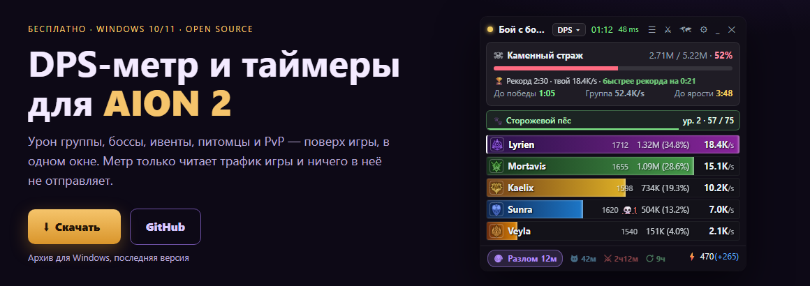

  

<h1 align="center">AION 2 Overlay</h1>

<b>DPS-метр и таймеры для AION 2</b> · урон группы, боссы, ивенты, питомцы и PvP — поверх игры, в одном окне

  
  
  

Бесплатно · Windows 10/11 · RU / EN на сайте · обновляется сам

---

## Возможности

**Бой**
- DPS, урон и доля каждого; клик по нику — скиллы, крит, перфект, график DPS, баффы
- Карточка босса: HP, **«До победы»**, **«До ярости»**; **рекорды** по каждому боссу и темп «быстрее / медленнее рекорда»
- Сила снаряжения рядом с ником, **разбор смерти** (кто и чем бил за 6 секунд до неё)
- Режимы в шапке окна: **DPS · Урон · Хил · Манекен · Гринд · PvP**
- **Манекен:** замер ровно минуту с твоего первого удара по чучелу
- **PvP:** урон игроков по игрокам, «Нанёс» / «Получил» по скиллам, кто кого убил
- «Только моя группа», история боёв, сводка боя в буфер обмена

**Таймеры и прочее**
- Полевые боссы — отдельное окно со звуком; разлом, шуго, арена, сброс — иконки с отсчётом в главном окне
- **Питомцы:** бьёшь моба — видно, чей питомец и сколько душ из нужного; вкладка со всеми питомцами
- Энергия «⚡ 75 (+990)», карта скрытых кубов
- Темы, полосы, шрифт, прозрачность, компактный режим, горячие клавиши, сквозной клик

## Установка

1. Установи [Npcap](https://npcap.com/) (нужен для чтения сетевых пакетов; у всех ДПС-метров он один и тот же).
2. Скачай `Aion2Overlay-v…-win-x64.zip` со страницы [релизов](https://github.com/drixed/aion2-overlay/releases/latest)
   и распакуй в любую папку.
3. Запусти `AionDpsMeter.UI.exe`. Игра — в режиме **«окно без рамки»** (borderless), иначе оверлей не виден поверх неё.

.NET ставить не нужно — всё уже внутри. Если Windows предупредит о неизвестной программе:
«Подробнее» → «Выполнить в любом случае».

Подробная инструкция: [docs/USAGE.ru.md](../docs/USAGE.ru.md).

## Обновления

- **Программа:** при запуске проверяет новую версию; в главном окне появится «⬆ Что нового» — одно нажатие, и она
  обновится сама. Настройки и история сохраняются.
- **Под патчи игры:** каждый день сборка автоматически подтягивает исправления разбора пакетов и выпускает новую версию.
  Если патч игры её сломал, в программе появится объявление «Метр обновляется под новый патч», пока исправление не выйдет.
- **Расписание** разломов и ивентов лежит в [`schedule.json`](../schedule.json) и подхватывается без новой версии.

## Безопасность аккаунта

Программа только **читает** сетевые пакеты (как и все ДПС-метры): ничего не встраивает в игру, не читает её память
и ничего не отправляет на сервер. Официального разрешения NCSOFT на сторонние метры нет — пользуйся на свой риск.

## Основано на

Форк [RATmeter](https://github.com/Kuroukihime/AIon2-Dps-Meter) (разбор пакетов, ДПС, окна подробностей),
с частями из [aion2-dps-meter](https://github.com/cyberbadger6969/aion2-dps-meter) (список полевых боссов, загрузка карты)
и данными NPC из [A2Tools-DPS-Meter](https://github.com/taengu/A2Tools-DPS-Meter). Лицензия — [GPL-3.0](../LICENSE).
Данные игры © NCSOFT. Проект не связан с NCSOFT.
